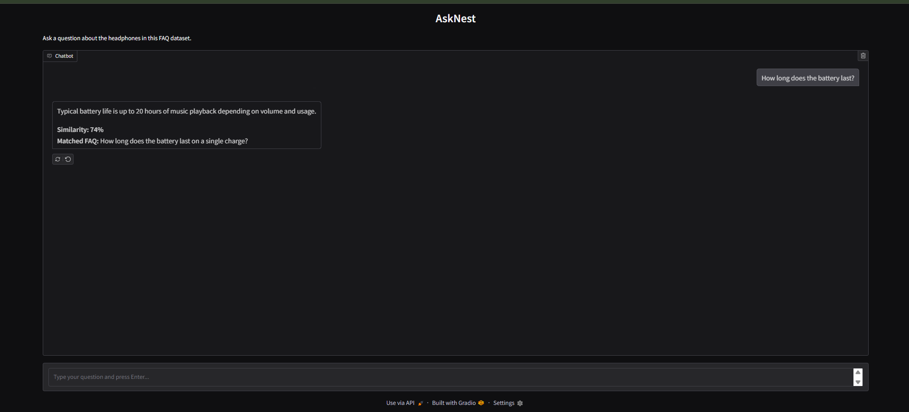

# AskNest

Ask a question. Find your answer.

A lightweight FAQ chatbot for headphone questions built with Python, spaCy, TF-IDF, cosine similarity, and Gradio.



## Features

- Natural-language FAQ matching
- spaCy-based text preprocessing and lemmatization
- TF-IDF vectorization
- Cosine similarity matching
- Confidence threshold for rejecting unrelated questions
- Displays the matched FAQ and similarity score for confident matches
- Local Gradio web interface
- Automated tests for core chatbot behavior

## How It Works

1. The user enters a question in the Gradio interface.
2. spaCy preprocesses the question and FAQ questions by lowercasing, removing stop words and non-alphabetic tokens, and lemmatizing the remaining words.
3. TF-IDF converts the processed FAQ questions into numerical vectors and transforms the user's question into the same vector space.
4. Cosine similarity compares the user's question vector with the FAQ question vectors.
5. The highest-scoring FAQ is selected.
6. If the similarity is at least 25%, AskNest returns the answer and matched FAQ.
7. Otherwise, AskNest rejects the match and asks the user to rephrase.

```text
User Question
     ↓
Gradio Interface
     ↓
spaCy Preprocessing
     ↓
TF-IDF Vectorization
     ↓
Cosine Similarity
     ↓
Confidence Threshold
     ↓
FAQ Answer / Rejection
```

## Project files

- `chatbot_for_faqs.py` — Gradio application and FAQ matching logic.
- `faqs.csv` — source questions and answers, loaded from beside the Python file.
- `requirements.txt` — Python package dependencies.
- `tests/test_chatbot.py` — automated tests for core chatbot behavior.
- `assets/asknest-demo.png` — application screenshot shown above.
- `.gitignore` — local environment and generated-file exclusions.

## Requirements

Use Python 3.9 or newer. Install the packages and the spaCy English model:

```bash
python -m pip install -r requirements.txt
python -m spacy download en_core_web_sm
```

## Run locally

From the project directory, start the app with:

```bash
python chatbot_for_faqs.py
```

The app prints a local Gradio URL in the terminal. Open it in a browser and ask a headphone FAQ. The app locates `faqs.csv` relative to its own file, so it can be started from another working directory.

## Matching behavior

AskNest lowercases FAQ and user questions, removes stop words and non-alphabetic tokens, and lemmatizes the remaining words with spaCy. It builds TF-IDF vectors from the FAQ questions and compares each processed user question with them using cosine similarity. At a similarity score of 25% or higher, it returns the corresponding answer and displays the matched FAQ and score. Below that threshold, it reports that no confident answer was found and shows the closest-match score without presenting an answer or matched FAQ.

The threshold is a simple starting point for this small sample dataset. Adjust `MATCH_THRESHOLD` in `chatbot_for_faqs.py` after trying representative questions if you expand the FAQs.

## Testing

Run the complete test suite from the project directory:

```bash
python -m unittest discover -s tests -v
```

The current test suite contains 6 tests covering FAQ loading, expected answers, unrelated-question rejection, empty input handling, and FAQ dataset validation.
